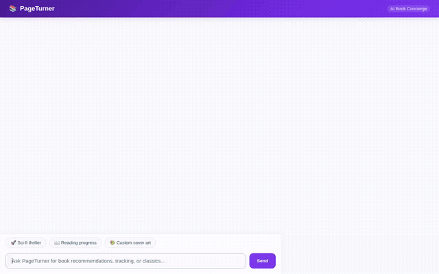

# 📖 Book Concierge (PageTurner)

A conversational AI book concierge built on Google Cloud that helps readers discover next reads, manage personal reading goals, track reading progress, generate custom book cover art and trailer videos, and interact through rich agent-driven visual cards.

<div align="center">



</div>

---

## 🌟 What the Agent Does

PageTurner interacts as a personalized literary guide and reading tracker with persistent memory and multimodal generation:

- **Personalized Recommendations & Memory**: Recalls reading tastes, favorite genres, favorite authors, and sensitivities across conversations via Vertex AI Memory Bank.
- **Reading List & Catalog Tracking**: Queries and updates a personal reading catalog stored in Cloud Firestore (`Want to Read`, `Currently Reading`, `Finished`) with page-by-page progress.
- **External Book Search**: Searches live book metadata, publication details, and cover images across millions of titles via the Open Library API.
- **Public Domain Ebooks**: Finds free, full-text classic ebooks with direct read and EPUB download links via Project Gutenberg (Gutendex).
- **Custom Cover Art Generation**: Generates original book cover art and scene depictions on demand using Google's `gemini-3.1-flash-lite-image` model, persists artifacts, and hosts them via Google Cloud Storage.
- **Book Trailer Video Teasers**: Generates short animated teasers and dramatic scene trailers using `gemini-omni-flash-preview`, uploads them to Google Cloud Storage, and saves them to the agent runtime artifacts panel.
- **Safe Code Execution Sandbox**: Executes Python calculations securely inside an Agent Engine sandbox for reading pace analysis, page rate tracking, and reading goal estimates.
- **Rich Visual Cards (A2UI)**: Returns structured visual cards (images, details, status) natively rendered in both the ADK Web Playground and the custom chat web frontend.

---

## ☁️ Google Cloud Services & Architecture

Based directly on the codebase in this repository:

| Service / Component | Role in Project | Implementation Details |
|---|---|---|
| **Vertex AI Agent Engine (Agent Runtime)** | Core reasoning loop & deployment target | Deployed using `agents-cli` 1.4.0 with Gemini 3.8 Flash (`gemini-3.8-flash`) |
| **Vertex AI Memory Bank** | Cross-session long-term memory | `PreloadMemoryTool` loads user profile/facts on turn start; `generate_memories_callback` persists memories on turn finish |
| **Cloud Firestore** | Structured catalog & reading list database | `books` collection stores book metadata, reading status, current page, ratings, and synopses |
| **Cloud Storage (GCS)** | Public hosting for generated media | Public bucket stores generated cover art images and trailer videos with public HTTPS URLs |
| **Vertex AI Imagen / Flash Image** | On-demand book cover art generation | `gemini-3.1-flash-lite-image` generates cover art and scene visuals |
| **Gemini Omni** | Short video trailer generation | `gemini-omni-flash-preview` generates animated book trailers and teasers |
| **Agent Engine Sandbox** | Safe code execution | `AgentEngineSandboxCodeExecutor` safely evaluates user reading statistics and goal timelines |
| **A2UI (Agent-to-UI)** | Visual component protocol | `a2ui_callback` converts structured model responses into cards, columns, rows, images, and text |
| **Cloud Run** | Custom chat web frontend hosting | FastAPI chat UI communicating with the agent runtime over the A2A protocol |

---

## 🛠️ Implemented Tools (`app/tools.py` & `app/agent.py`)

- `list_books(status, genre)`: Filters and retrieves books from Firestore.
- `get_book_details(title_or_id)`: Fetches full details for a book from Firestore.
- `add_or_update_book(...)`: Saves new books or updates existing catalog records in Firestore.
- `update_reading_progress(title_or_id, current_page, status)`: Updates current page count and transitions reading status.
- `search_open_library(query, limit)`: Live queries Open Library for metadata and cover art.
- `search_free_ebooks(query, limit)`: Queries Project Gutenberg via Gutendex for public-domain classics and download links.
- `generate_book_cover(prompt)`: Generates cover art via `gemini-3.1-flash-lite-image`, saves runtime artifact, and uploads to Cloud Storage.
- `generate_book_trailer_video(prompt)`: Generates animated video teaser via `gemini-omni-flash-preview`, saves runtime artifact, and uploads to Cloud Storage.
- `PreloadMemoryTool()`: Reads user facts and preferences from Vertex AI Memory Bank into agent context.

> [!NOTE]
> **Planned / Stretch Capabilities**: An automated scheduled reading reminder notification and vector-based semantic RAG search over full book texts were conceptualized in planning but are not yet implemented in the agent logic.

---

## 📂 Project Structure

```text
.
├── README.md                      # Project documentation and architecture
├── agent_demo.gif                 # Looping demo recording
├── agent_demo.webm                # Source WebM recording
├── project_brief.md               # Original design brief
└── book-concierge/
    ├── agents-cli-manifest.yaml   # Agent manifest configuration
    ├── pyproject.toml             # Python dependencies (uv / ADK)
    ├── seed_firestore.py          # Script to seed initial book catalog
    ├── app/
    │   ├── agent.py               # Root agent definition, system prompts, callbacks
    │   ├── tools.py               # Firestore, external API, image, and video tools
    │   ├── a2ui_utils.py          # A2UI response formatting callback
    │   └── fast_api_app.py        # Local backend server
    └── frontend/
        ├── main.py                # FastAPI proxy server (A2A protocol client)
        ├── requirements.txt       # Frontend dependencies
        └── static/                # Branded chat UI with A2UI renderer
```

---

## 🚀 How to Run Locally

### 1. Prerequisites
- Python 3.11+
- Google Cloud SDK (`gcloud`) authenticated with your project:
  ```bash
  gcloud auth login
  gcloud auth application-default login
  gcloud config set project <YOUR_PROJECT_ID>
  ```
- Google Cloud APIs enabled:
  ```bash
  gcloud services enable aiplatform.googleapis.com firestore.googleapis.com storage.googleapis.com
  ```
- `uv` package manager and `agents-cli`:
  ```bash
  pip install uv
  uv tool install google-agents-cli
  ```

### 2. Environment Configuration
From the project root:

```bash
cd book-concierge
cp .env.example .env
```

Edit `.env` and set:
- `GOOGLE_CLOUD_PROJECT`: Your Google Cloud Project ID (e.g. `my-book-project`).
- `GCS_BUCKET_NAME`: The Cloud Storage bucket name in your project for generated book covers and trailers (required for `generate_book_cover` and `generate_book_trailer_video`).

### 3. (Optional) Seed the Firestore Catalog
Initialize your Cloud Firestore database with the starter book list:

```bash
# Run from inside book-concierge/
python seed_firestore.py
```

### 4. Run the Agent in ADK Playground
Navigate to the agent directory, install dependencies, and launch the interactive development playground:

```bash
# Run from inside book-concierge/
agents-cli install
agents-cli playground
```

Inspect live memory, test function tool calls, and view generated artifacts directly in the playground UI.

### 5. Run the Custom Chat Frontend
In a separate terminal window, launch the branded chat frontend:

```bash
# From project root:
cd book-concierge/frontend
pip install -r requirements.txt

# Set the deployed Agent Engine resource name (found in deployment_metadata.json or agents-cli deploy output)
export AGENT_ENGINE_RESOURCE_NAME="projects/<PROJECT_NUMBER>/locations/<REGION>/reasoningEngines/<ENGINE_ID>"
export AGENT_DIRECTORY="app"
python main.py
```

The frontend will run locally on port 8080 and proxy user interactions to your agent runtime over the A2A protocol.
